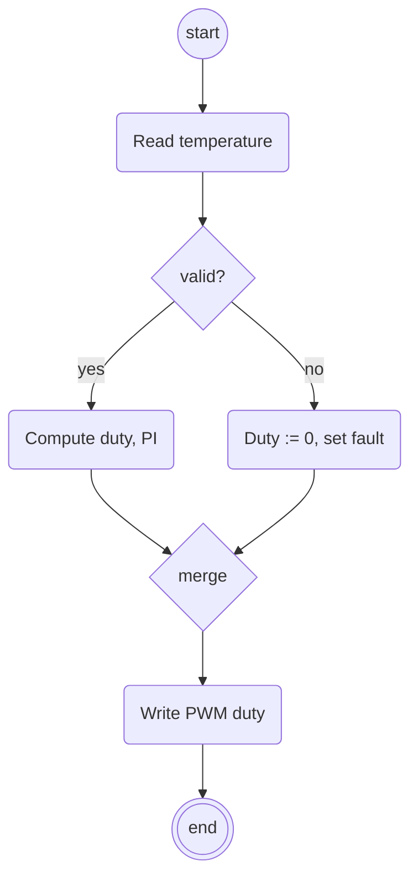

<!-- Generated by spec-figures scripts/continue_rules.py from llm/ -- edit llm/ there and rerun, don't edit this file. -->

# Figure: Activity diagram

The control flow of a function or procedure: actions, decisions, parallel paths. Typical in the design chapter of a unit specification (algorithm of one function) and for test procedures.

## TikZ: `\begin{sfActivity}[options]` … `\end{sfActivity}`

- **`\Start[c,r]{ID}`**, **`\End[c,r]{ID}`:** initial and final node.
- **`\Action[c,r]{ID}{text}`:** an action (rounded box). `\Object[c,r]{ID}{name}`: an object or data node (box).
- **`\Decision[c,r]{ID}{question}`:** decision (diamond); put the guards on the outgoing flows. `\Merge[c,r]{ID}`: merge of alternative paths (small diamond).
- **`\Fork[c,r]{ID}`**, **`\Join[c,r]{ID}`:** start and end of parallel paths (black bar).
- **`\Flow[options]{from}{to}{guard}`:** arrow; guard e.g. `yes`, `[temp > max]`, or empty.
- **`\Partition{name}{IDs}`:** a frame with a name around the listed elements (responsibility, swimlane-like).
- **Options:** `xstep` (default 3.6cm), `ystep` (default 1.4cm).
- **Layout:** top-down: without a position an element goes below the previous one. Put side branches in column 1 (`[1,3]`) and route their flows with `[hv]` / `[vh]`.
- **Red marks:** unknown or duplicate ID, bad position.

## Mermaid: `flowchart TD`

- Mermaid has no activity diagram; use a flowchart: `s((start))` initial, `e(((end)))` final, `a(Action text)` action, `d{question}` decision, `m{merge}` merge.
- `a --> b`, guards as `d -- yes --> b`.
- Parallel paths: draw them as separate branches; there is no fork bar.

## From a table

- Step list with columns *step*, *action*, *next step(s)*, *condition* → one `\Action` per step, one `\Flow` per next step with the condition as guard; a step with several conditional next steps becomes `\Decision`.

## Examples

## TikZ example (figures/sample/activity.tex)

```latex
% Activity diagram: one control step
\begin{sfActivity}
  \Start{s}
  \Action{read}{Read temperature}
  \Decision{valid}{valid?}
  \Action{pi}{Compute duty (PI)}
  \Merge{m}
  \Action{out}{Write PWM duty}
  \End{e}
  \Action[1,3]{safe}{Duty := 0, set fault}
  \Flow{s}{read}{}
  \Flow{read}{valid}{}
  \Flow{valid}{pi}{yes}
  \Flow[hv]{valid}{safe}{no}
  \Flow{pi}{m}{}
  \Flow[vh]{safe}{m}{}
  \Flow{m}{out}{}
  \Flow{out}{e}{}
\end{sfActivity}
```

## Mermaid / Markdown example (mermaid/activity.mmd)


