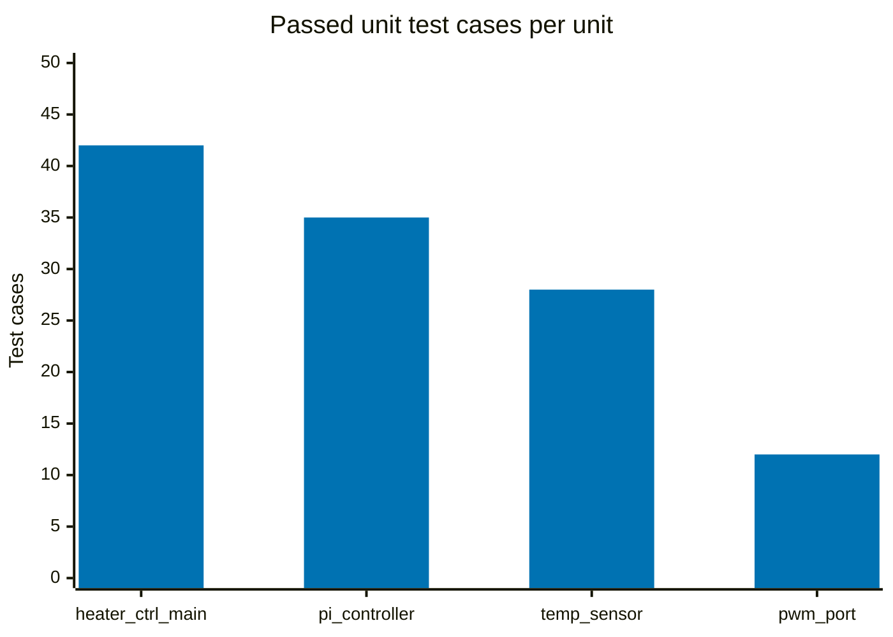

<!-- Generated by spec-figures scripts/continue_rules.py from llm/ -- edit llm/ there and rerun, don't edit this file. -->

# Figure: Bar chart

Values per category as bars, one series or several series side by side. Typical for test results per unit, findings per review, effort per work package in a project manual or a test report.

## TikZ: `\begin{sfBarChart}[options]` … `\end{sfBarChart}`

- **`\Bar{category}{value}`:** one bar of a single-series chart, in reading order; the value is printed above the bar.
- **`\Categories{a, b, …}`** + **`\Series{name}{v1, v2, …}`:** grouped bars: one value per category per series, in the order of `\Categories`. Use either `\Bar` or `\Categories`/`\Series`, not both.
- **`\Threshold{value}{label}`:** dashed red line across the chart, e.g. a limit.
- **Options:** `width` (plot, default 12cm), `height` (plot, default 5.5cm), `xlabel`, `ylabel` (axis titles; escape `\%`).
- **Layout:** value axis from 0 (or from the lowest negative value) with 1/2/5 × 10^k steps; categories evenly spaced, long names wrap. Legend under the chart when there is more than one series. Colours are fixed, colour-blind safe; at most 6 series.
- **Red marks:** value not a number, a series with more or fewer values than categories, both `\Bar` and `\Series`, no categories, more than 6 series, unknown option.

## Mermaid: `xychart-beta`

- Start with the `---` config block of the example (bar colour; the default is too pale), then the `%%` comment line.
- `x-axis ["a", "b", …]` with categories in quotes, `y-axis "title" 0 --> max`, then `bar [v1, v2, …]`.
- One `bar` line per chart: several `bar` lines are drawn on top of each other, not side by side, and there is no legend. For several series make one chart each, or use the TikZ form.
- Numbers only in the data lists, no units; put units into the axis title.

## From a table

- Two columns (*category*, *value*) → one `\Bar` per row. A table with one category column and several value columns → `\Categories` from the first column, one `\Series` per value column (column header = series name).

## Examples

## TikZ example (tikz/barchart.tex)

```latex
% Bar chart: unit test results per unit of heater_ctrl (grouped: passed / failed / blocked)
\begin{sfBarChart}[ylabel=Test cases, height=5cm]
  \Categories{heater_ctrl_main, pi_controller, temp_sensor, pwm_port}
  \Series{passed}{42, 35, 28, 12}
  \Series{failed}{2, 0, 3, 1}
  \Series{blocked}{1, 0, 0, 4}
\end{sfBarChart}
```

## Mermaid / Markdown example (mermaid/barchart.mmd)


