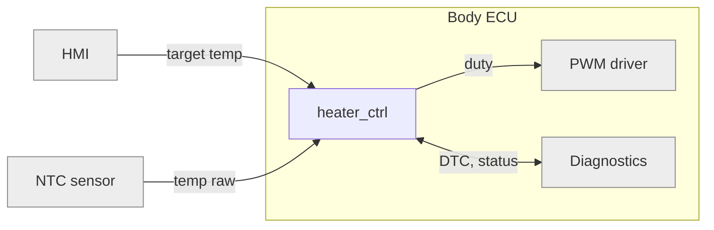

<!-- Generated by spec-figures scripts/continue_rules.py from llm/ -- edit llm/ there and rerun, don't edit this file. -->

# Figure: Block / context diagram

Blocks and the signals or data flowing between them: the context of a component (what is inside, what is outside) or a signal flow. Typical in the introduction or architecture chapter of a component specification and in unit specifications (unit context).

## TikZ: `\begin{sfBlock}[options]` … `\end{sfBlock}`

- **`\Block[c,r]{ID}{name}`:** a block in scope (box). `\External[c,r]{ID}{name}`: a block outside the scope (grey box). `\Store[c,r]{ID}{name}`: memory, NVM, database (cylinder).
- **`\Signal[options]{from}{to}{label}`:** a signal or data flow (arrow).
- **`\Exchange[options]{a}{b}{label}`:** a two-way exchange (arrow at both ends).
- **`\Group{name}{IDs}`:** a frame with a name around the listed blocks (an ECU, a component, a subsystem).
- **Options:** `xstep` (default 4.6cm), `ystep` (default 1.8cm).
- **Layout:** grid `[column,row]`; context diagram: the block in scope in the middle column, inputs left (column 0), outputs right (column 2).
- **Red marks:** unknown or duplicate ID, bad position.

## Mermaid: `flowchart LR`

- Blocks `a[Name]`, external blocks styled with `classDef ext fill:#EDEDED,stroke:#8A8A8A` and `class a,b ext`, groups as `subgraph id [name]` … `end`.
- `a -- label --> b`, two-way `a <-->|label| b`.

## From a table

- Signal list with columns *signal*, *source*, *sink* (optionally *type*, *rate*) → one block per distinct source/sink, one `\Signal{source}{sink}{signal}` per row; signals with the same source and sink: one arrow with the names joined by commas.

## Examples

## TikZ example (tikz/block.tex)

```latex
% Block / context diagram: heater_ctrl in its environment
\begin{sfBlock}
  \External[0,0]{hmi}{HMI}
  \Block[1,0.5]{ctrl}{heater_ctrl}
  \External[2,0]{pwm}{PWM driver}
  \External[0,1]{ntc}{NTC sensor}
  \External[2,1]{diag}{Diagnostics}
  \Signal{hmi}{ctrl}{target temp}
  \Signal{ntc}{ctrl}{temp raw}
  \Signal{ctrl}{pwm}{duty}
  \Exchange{ctrl}{diag}{DTC, status}
  \Group{Body ECU}{ctrl, pwm, diag}
\end{sfBlock}
```

## Mermaid / Markdown example (mermaid/block.mmd)


