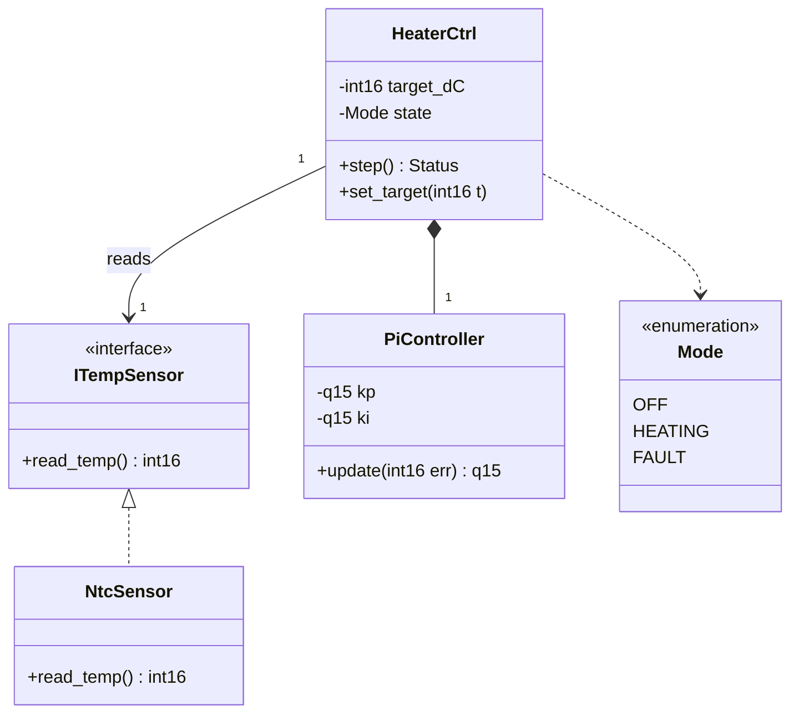

<!-- Generated by spec-figures scripts/continue_rules.py from llm/ -- edit llm/ there and rerun, don't edit this file. -->

# Figure: Class diagram

Classes, interfaces and data types with their attributes, operations and relations. Typical in the design chapter of a unit specification (static structure, data types) and in component specifications (interfaces).

## TikZ: `\begin{sfClassDiagram}[options]` … `\end{sfClassDiagram}`

- **`\Class[c,r]{ID}{name}`**, `\AbstractClass[c,r]{ID}{name}`, `\Interface[c,r]{ID}{name}`, `\Enumeration[c,r]{ID}{name}`: the element, drawn with three compartments.
- **`\Attribute{text}`:** an attribute of the element just declared, e.g. `- target_dC: int16`. `\Literal{text}`: a value of an enumeration.
- **`\Operation{text}`:** an operation, e.g. `+ step(): Status`.
- **Relations** `\Cmd[options]{from}{to}{label}`: `\Association` (line), `\DirectedAssociation` (open arrow), `\Composition{whole}{part}{label}` (filled diamond at the whole), `\Aggregation{whole}{part}{label}` (hollow diamond), `\Dependency{client}{supplier}{label}` (dashed arrow). Multiplicities with `[m1=1, m2=0..*]`.
- **`\Inherits[options]{child}{parent}`**, **`\Implements[options]{class}{interface}`:** generalisation and realisation (hollow triangle, solid or dashed).
- **Options:** `xstep` (default 4.6cm), `ystep` (default 3cm; more if classes have many attributes).
- **Layout:** grid `[column,row]`; without a position a class goes right of the previous one. Put base classes and interfaces above (row 0) their subclasses.
- **Red marks:** unknown or duplicate ID, `\Attribute`/`\Operation` before any class, bad position.

## Mermaid: `classDiagram`

- `class ID { ... }` with attributes `-int16 target_dC` (visibility, type, name) and operations `+step() Status`; `<<interface>>` or `<<enumeration>>` as first line of the body.
- Relations: `A <|-- B` inheritance, `A <|.. B` realisation, `A *-- B` composition, `A o-- B` aggregation, `A --> B` directed association, `A ..> B` dependency, `A "1" --> "0..*" B : label`.
- Class names without spaces.

## From a table

- Data dictionary with columns *type*, *member*, *data type*, *visibility* → one element per distinct type, one `\Attribute{visibility member: data type}` per row. Interface tables with *function*, *parameters*, *return* → `\Operation`s of an `\Interface`.

## Examples

## TikZ example (figures/sample/class.tex)

```latex
% Class diagram: heater_ctrl software structure
\begin{sfClassDiagram}
  \Interface[0,0]{isens}{ITempSensor}
    \Operation{+ read_temp(): int16}
  \Class[1,0]{ctrl}{HeaterCtrl}
    \Attribute{- target_dC: int16}
    \Attribute{- state: Mode}
    \Operation{+ step(): Status}
    \Operation{+ set_target(t: int16)}
  \Class[2,0]{pi}{PiController}
    \Attribute{- kp, ki: q15}
    \Operation{+ update(err: int16): q15}
  \Class[0,1.2]{ntc}{NtcSensor}
    \Operation{+ read_temp(): int16}
  \Enumeration[1,1.2]{mode}{Mode}
    \Literal{OFF}
    \Literal{HEATING}
    \Literal{FAULT}
  \Implements{ntc}{isens}
  \Association[m1=1, m2=1]{ctrl}{isens}{reads}
  \Composition[m2=1]{ctrl}{pi}{}
  \Dependency{ctrl}{mode}{}
\end{sfClassDiagram}
```

## Mermaid / Markdown example (mermaid/class.mmd)


