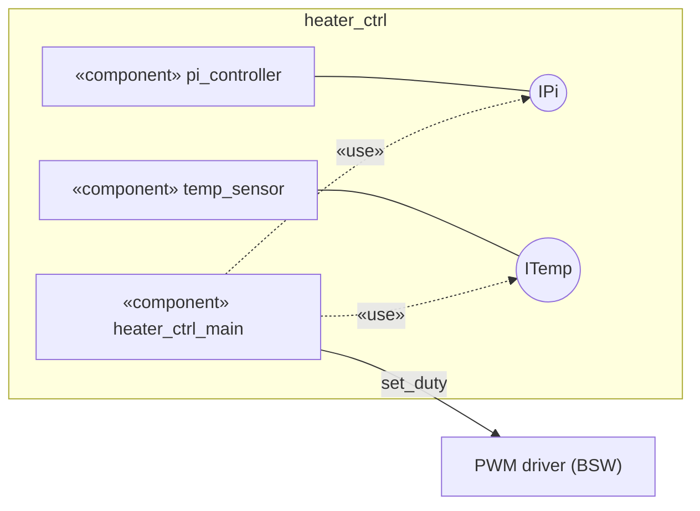

<!-- Generated by spec-figures scripts/continue_rules.py from llm/ -- edit llm/ there and rerun, don't edit this file. -->

# Figure: Component diagram

Software components or units, their provided and required interfaces and the connections between them. Typical in the architecture chapter of a component specification (units of the component, interfaces to the outside).

## TikZ: `\begin{sfComponent}[options]` … `\end{sfComponent}`

- **`\Component[c,r]{ID}{name}`:** a component or unit (box with component icon). `\External[c,r]{ID}{name}`: something outside the scope (grey box: driver, BSW, other component).
- **`\Interface[c,r]{ID}{name}`:** an interface (small circle, "lollipop"), name below.
- **`\Provides[options]{component}{interface}`:** the component implements the interface (solid line).
- **`\Requires[options]{component}{interface}`:** the component uses the interface (dashed arrow «use»).
- **`\Connect[options]{from}{to}{label}`:** a direct connection or data flow (arrow).
- **`\Boundary{name}{IDs}`:** a frame with a name around the listed elements (the component around its units).
- **Options:** `xstep` (default 3.6cm), `ystep` (default 2cm).
- **Layout:** grid `[column,row]`; place each interface between its provider and its users (e.g. `[1,0]` between `[0,0]` and `[2,0]`), externals outside the boundary.
- **Red marks:** unknown or duplicate ID, bad position.

## Mermaid: `flowchart LR`

- Components as boxes `c["«component» name"]`, interfaces as circles `i((IName))`, the boundary as `subgraph id [name]` … `end`.
- Provides `c --- i`, requires `c -. "«use»" .-> i`, connection `a -- label --> b`.

## From a table

- Interface table with columns *interface*, *provided by*, *used by* → one `\Interface` per row, one `\Provides`, and one `\Requires` per entry in *used by*.

## Examples

## TikZ example (tikz/component.tex)

```latex
% Component diagram: units of heater_ctrl and their interfaces
\begin{sfComponent}
  \Component[0,0]{ctrl}{heater_ctrl_main}
  \Interface[1,0]{ipi}{IPi}
  \Component[2,0]{pi}{pi_controller}
  \Interface[0,0.8]{itemp}{ITemp}
  \Component[0,1.6]{sens}{temp_sensor}
  \External[3,1.6]{pwm}{PWM driver\\(BSW)}
  \Provides{pi}{ipi}
  \Requires{ctrl}{ipi}
  \Provides{sens}{itemp}
  \Requires{ctrl}{itemp}
  \Connect{ctrl}{pwm}{set_duty}
  \Boundary{heater_ctrl}{ctrl, pi, sens, ipi, itemp}
\end{sfComponent}
```

## Mermaid / Markdown example (mermaid/component.mmd)


