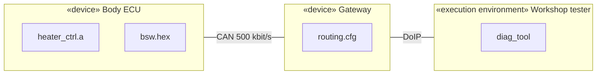

<!-- Generated by spec-figures scripts/continue_rules.py from llm/ -- edit llm/ there and rerun, don't edit this file. -->

# Figure: Deployment diagram

Hardware and execution environments, the artifacts deployed on them and the communication links. Typical in component specifications (target ECU, test benches) and in project manuals (build and test environments).

## TikZ: `\begin{sfDeployment}[options]` … `\end{sfDeployment}`

- **`\Node[c,r]{ID}{name}[stereotype]`:** a device or execution environment (3D box). The stereotype defaults to `device`; others: `execution environment`, `test bench`, `server`, ….
- **`\Artifact{name}`:** an artifact deployed on the node just declared (binary, library, configuration); listed under the name.
- **`\Link[options]{from}{to}{label}`:** a communication path, label = bus or protocol (`CAN 500 kbit/s`).
- **`\Dependency[options]{from}{to}{label}`:** dashed arrow.
- **Options:** `xstep` (default 5.4cm), `ystep` (default 2.6cm).
- **Layout:** grid `[column,row]`; without a position a node goes right of the previous one.
- **Red marks:** unknown or duplicate ID, `\Artifact` before any node, bad position.

## Mermaid: `flowchart LR`

- Nodes as `subgraph id ["«device» Name"]` … `end` with artifacts as boxes inside.
- Links between subgraphs: `a ---|CAN 500 kbit/s| b`.

## From a table

- Deployment table with columns *artifact*, *node*, and a link list *node A*, *node B*, *protocol* → one `\Node` per distinct node, `\Artifact` lines under it, one `\Link` per link row.

## Examples

## TikZ example (figures/sample/deployment.tex)

```latex
% Deployment diagram: where heater_ctrl runs
\begin{sfDeployment}
  \Node[0,0]{ecu}{Body ECU}
    \Artifact{heater_ctrl.a}
    \Artifact{bsw.hex}
  \Node[1,0]{gw}{Gateway}
    \Artifact{routing.cfg}
  \Node[2,0]{tester}{Workshop tester}[execution environment]
    \Artifact{diag_tool}
  \Link{ecu}{gw}{CAN 500 kbit/s}
  \Link{gw}{tester}{DoIP}
\end{sfDeployment}
```

## Mermaid / Markdown example (mermaid/deployment.mmd)


