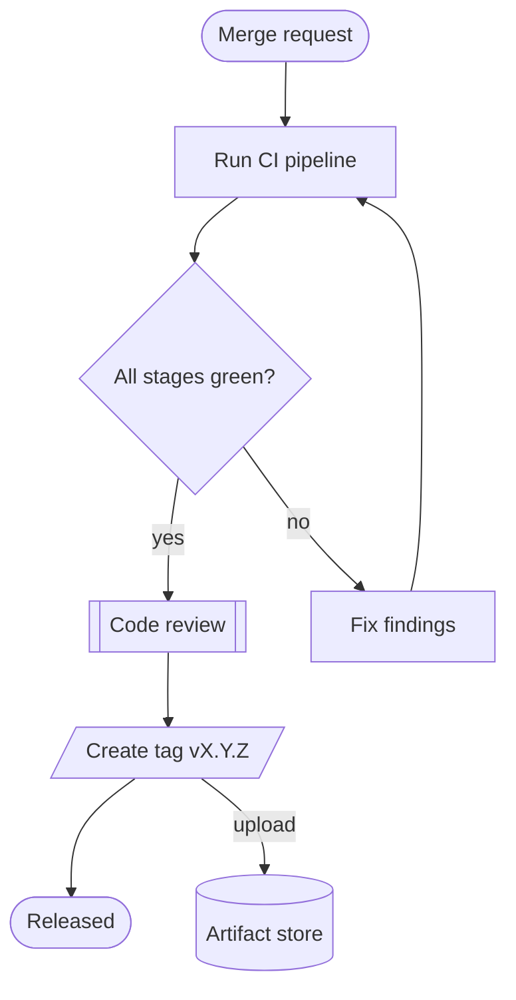

<!-- Generated by spec-figures scripts/continue_rules.py from llm/ -- edit llm/ there and rerun, don't edit this file. -->

# Figure: Flowchart

A process or decision procedure with classic flowchart symbols: release flow, review procedure, error handling, test procedure. Typical in project manuals (workflows, how-tos) and test specifications.

## TikZ: `\begin{sfFlowchart}[options]` … `\end{sfFlowchart}`

- **`\Terminal[c,r]{ID}{text}`:** start or end (rounded ends).
- **`\Process[c,r]{ID}{text}`:** a step (box). `\Subprocess[c,r]{ID}{text}`: a predefined process, described elsewhere (box with side bars).
- **`\Decision[c,r]{ID}{question}`:** decision (diamond); put the answers on the outgoing flows.
- **`\InOut[c,r]{ID}{text}`:** input or output (parallelogram). `\Store[c,r]{ID}{text}`: data store, database, repository (cylinder).
- **`\Flow[options]{from}{to}{label}`:** arrow with optional label (`yes`, `no`, `upload`).
- **Options:** `xstep` (default 4.2cm), `ystep` (default 1.6cm).
- **Layout:** top-down: without a position an element goes below the previous one. Put side branches in column 1 and route loops back with `[vh]` or `[hv]`.
- **Red marks:** unknown or duplicate ID, bad position.

## Mermaid: `flowchart TD`

- Shapes: `a([Terminal])`, `b[Process]`, `c[[Subprocess]]`, `d{Decision?}`, `e[/Input or output/]`, `f[(Store)]`.
- `a --> b`, labelled `d -- yes --> b` or `a -->|text| b`.
- Quote labels with special characters: `d{"All stages green?"}`.

## From a table

- Step list with columns *ID*, *type* (start, step, decision, io, store, end), *text*, *next* (comma list, optionally `ID:label`) → one element command per row, one `\Flow` per entry in *next*.

## Examples

## TikZ example (tikz/flowchart.tex)

```latex
% Flowchart: release decision
\begin{sfFlowchart}
  \Terminal{start}{Merge request}
  \Process{ci}{Run CI pipeline}
  \Decision{green}{All stages\\green?}
  \Subprocess{review}{Code review}
  \InOut{tag}{Create tag vX.Y.Z}
  \Terminal{done}{Released}
  \Process[1,2]{fix}{Fix findings}
  \Store[1,4]{repo}{Artifact store}
  \Flow{start}{ci}{}
  \Flow{ci}{green}{}
  \Flow{green}{review}{yes}
  \Flow{green}{fix}{no}
  \Flow[vh]{fix}{ci}{}
  \Flow{review}{tag}{}
  \Flow{tag}{done}{}
  \Flow{tag}{repo}{upload}
\end{sfFlowchart}
```

## Mermaid / Markdown example (mermaid/flowchart.mmd)


