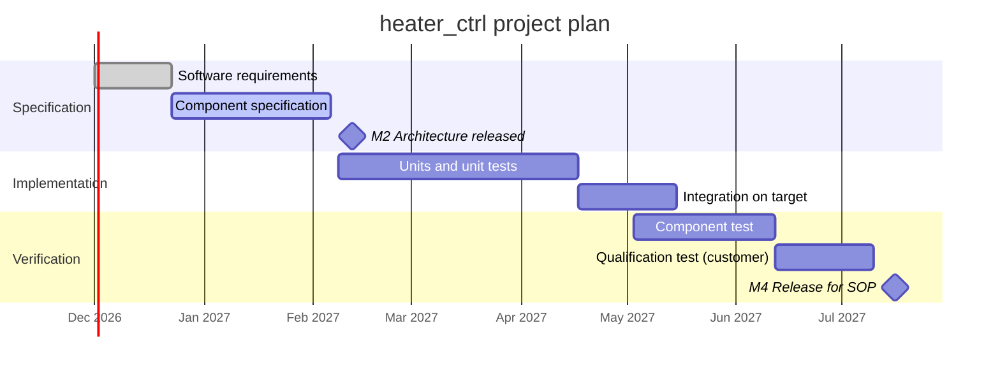

<!-- Generated by spec-figures scripts/continue_rules.py from llm/ -- edit llm/ there and rerun, don't edit this file. -->

# Figure: Gantt chart

Tasks of a project on a date axis, grouped by phase, with milestones, dependencies and progress. Typical in the project manual (schedule) and in plans that a specification references.

## TikZ: `\begin{sfGantt}[options]` … `\end{sfGantt}`

- **`\Group{name}`:** a phase or work package; a bold row with a bar that spans its tasks. The tasks and milestones after it belong to it, up to the next `\Group`.
- **`\Task[progress]{ID}{name}{start}{end}`:** one bar from start to end, both dates `YYYY-MM-DD`, the end day included. Optional progress in percent without `%` (`\Task[60]{...}`): the done part is filled dark and the value is printed after the bar.
- **`\Milestone{ID}{name}{date}`:** a diamond at the date, on its own row.
- **`\Depends{from ID}{to ID}`:** arrow from the end of one task or milestone to the start of another (finish-to-start).
- **Options:** `width` (length of the date axis, default 11cm; the name column comes on top), `step` (row height, default 0.55cm), `today=YYYY-MM-DD` (dashed red line).
- **Layout:** one row per command in the given order; the axis spans the earliest start to the latest end. Spans over 10 weeks get month columns (the year at the first month and every January; every second month labelled for spans over a year), shorter spans get week columns starting on Mondays. Each group has its own bar colour. Up to about 20 rows and 2 years stay readable.
- **Red marks:** a date that is not `YYYY-MM-DD`, an end before the start, a duplicate ID, an unknown ID in `\Depends`, a progress that is not a number, `today` outside the chart.

## Mermaid: `gantt`

- Header lines: `title …`, `dateFormat YYYY-MM-DD`, `axisFormat %b %Y`.
- `section Name` per group; one task per line: `Name :tags, ID, start, end`. Tags (optional, comma-separated): `done`, `active`, `crit`, `milestone`.
- The end date is exclusive in Mermaid: give the day after the last working day, or a length like `10d` / `3w`.
- Start `after ID` for a dependency (`Integration :integ, after impl, 2027-05-15`).
- Milestone: `Name :milestone, ID, date, 0d`.
- No `:` `;` or `#` in task names; IDs without spaces.

## From a table

- Columns *phase*, *task*, *start*, *end*, optional *ID*, *progress*, *predecessor* → `\Group` for each new phase, then one `\Task[progress]{ID}{task}{start}{end}` per row; *predecessor* → `\Depends{predecessor}{ID}`. Rows with zero duration or type *milestone* → `\Milestone`. Missing IDs: make short ones from the task name.
- Dates in other formats (`01.12.2026`, `12/01/2026`) → convert to `YYYY-MM-DD`; ask when day and month order is unclear.
- Mermaid: the same rows as task lines, with end + 1 day.

## Examples

## TikZ example (tikz/gantt.tex)

```latex
% Gantt chart: plan of the heater_ctrl project, grouped by phase
\begin{sfGantt}[today=2027-02-15]
  \Group{Specification}
  \Task[100]{req}{Software requirements}{2026-12-01}{2026-12-22}
  \Task[80]{arch}{Component specification}{2027-01-04}{2027-02-05}
  \Milestone{m2}{M2 Architecture released}{2027-02-12}
  \Group{Implementation}
  \Task[40]{impl}{Units and unit tests}{2027-02-08}{2027-04-16}
  \Task{integ}{Integration on target}{2027-04-12}{2027-05-14}
  \Group{Verification}
  \Task{comp}{Component test}{2027-05-03}{2027-06-11}
  \Task{qual}{Qualification test (customer)}{2027-06-14}{2027-07-09}
  \Milestone{sop}{M4 Release for SOP}{2027-07-16}
  \Depends{req}{arch}
  \Depends{arch}{m2}
  \Depends{impl}{integ}
  \Depends{comp}{qual}
  \Depends{qual}{sop}
\end{sfGantt}
```

## Mermaid / Markdown example (mermaid/gantt.mmd)


