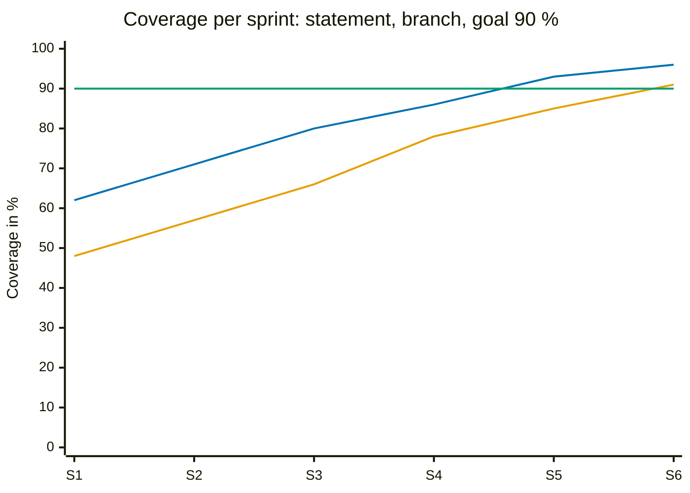

<!-- Generated by spec-figures scripts/continue_rules.py from llm/ -- edit llm/ there and rerun, don't edit this file. -->

# Figure: Line chart

One or more series of values over ordered categories (sprints, builds, releases, weeks). Typical for coverage, open findings or defect trends in a project manual, a test report or a quality status.

## TikZ: `\begin{sfLineChart}[options]` … `\end{sfLineChart}`

- **`\Categories{a, b, …}`:** the x positions, in order (e.g. `S1, S2, S3`).
- **`\Series{name}{v1, v2, …}`:** one line with marks, one value per category. A value that is not a number leaves a gap in the marks (the line joins the neighbours) and is reported.
- **`\Threshold{value}{label}`:** dashed red line with its label at the left, e.g. a coverage goal `\Threshold{90}{goal 90 \%}`.
- **Options:** `width` (plot, default 12cm), `height` (plot, default 5.5cm), `xlabel`, `ylabel` (escape `\%`).
- **Layout:** value axis from 0 (or from the lowest negative value) with 1/2/5 × 10^k steps, light grid; categories evenly spaced. Legend under the chart when there is more than one series; at most 6 series.
- **Red marks:** value not a number, a series with more or fewer values than categories, threshold not a number, more than 6 series, unknown option.

## Mermaid: `xychart-beta`

- Start with the `---` config block of the example (series colours; the default colours are too pale), then the `%%` comment line.
- `x-axis [S1, S2, …]`, `y-axis "title" 0 --> max`, one `line [v1, v2, …]` per series.
- There is no legend: name the series in the `title` in the order of the `line` lines. A threshold is a flat line `line [90, 90, …]` with one value per category.
- Numbers only in the data lists; quote category names that contain spaces or special characters.

## From a table

- First column = categories (sprint, build, date) → `\Categories`; each further column → one `\Series` named after its header. A target column with the same value in every row → `\Threshold`.

## Examples

## TikZ example (tikz/linechart.tex)

```latex
% Line chart: branch coverage of heater_ctrl per sprint against the 90 % goal
\begin{sfLineChart}[xlabel=Sprint, ylabel=Coverage in \%, height=5cm]
  \Categories{S1, S2, S3, S4, S5, S6}
  \Series{Statement}{62, 71, 80, 86, 93, 96}
  \Series{Branch}{48, 57, 66, 78, 85, 91}
  \Threshold{90}{goal 90 \%}
\end{sfLineChart}
```

## Mermaid / Markdown example (mermaid/linechart.mmd)


