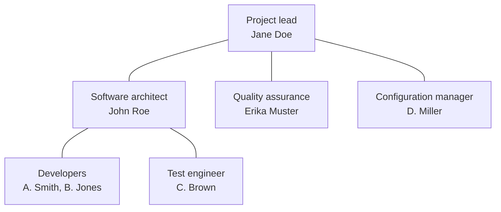

<!-- Generated by spec-figures scripts/continue_rules.py from llm/ -- edit llm/ there and rerun, don't edit this file. -->

# Figure: Organisation chart

Units or roles as a tree, each box with its title and the people in it. Typical in the project manual (organisation, roles) and in component specifications (responsibilities).

## TikZ: `\begin{sfOrgChart}[options]` … `\end{sfOrgChart}`

- **`\Unit[parent ID]{ID}{title}{people}`:** one box. Without `[parent ID]` the unit is a root. People: names separated by `\\` (one per line), or empty `{}`.
- **Options:** `xstep` (width of one column, default 3.4cm), `ystep` (distance between levels, default 2.1cm).
- **Layout:** automatic. Each level is one row, children are centred under their parent in the order given, subtrees never overlap. Several roots stand side by side. Up to about 5 boxes per level fit the page width; for wider trees split the chart or reduce `xstep`.
- **Red marks:** duplicate ID, unknown parent (the unit becomes a root), a unit that is its own parent, units on a parent cycle (not drawn).

## Mermaid: `flowchart TD`

- One node per unit: `ID["Title<br/>Name, Name"]`; `<br/>` (line break) is the only HTML allowed here.
- One line per parent link: `PARENT --- CHILD` (no arrow heads).
- Declare all nodes first, then the links, parents before children.
- IDs without spaces; never `end` as an ID.

## From a table

- Columns *ID*, *title*, *reports to*, *people* → one `\Unit[reports to]{ID}{title}{people}` per row, the people joined with `\\`. Several rows with the same unit and different people → one unit, people joined.
- Rows whose *reports to* is empty or outside the table are roots; say so in the open points.

## Examples

## TikZ example (tikz/orgchart.tex)

```latex
% Organisation chart: roles of the heater_ctrl project and who fills them
\begin{sfOrgChart}
  \Unit{PL}{Project lead}{Jane Doe}
  \Unit[PL]{SWA}{Software architect}{John Roe}
  \Unit[PL]{QA}{Quality assurance}{Erika Muster}
  \Unit[SWA]{DEV}{Developers}{A. Smith\\B. Jones}
  \Unit[SWA]{TST}{Test engineer}{C. Brown}
  \Unit[PL]{CM}{Configuration manager}{D. Miller}
\end{sfOrgChart}
```

## Mermaid / Markdown example (mermaid/orgchart.mmd)


