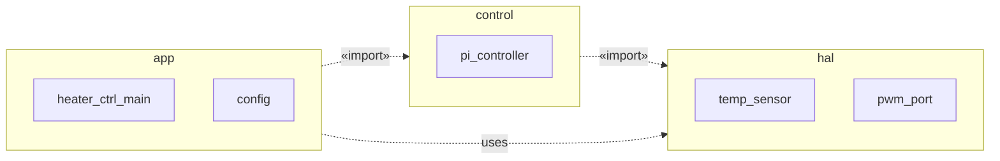

<!-- Generated by spec-figures scripts/continue_rules.py from llm/ -- edit llm/ there and rerun, don't edit this file. -->

# Figure: Package diagram

Packages, modules or directories and the dependencies between them: the layering of a component's code. Typical in component specifications (static architecture) and developer manuals (repository layout).

## TikZ: `\begin{sfPackage}[options]` … `\end{sfPackage}`

- **`\Package[c,r]{ID}{name}`:** a package (box with tab).
- **`\Element{name}`:** an element contained in the package just declared (module, unit, file); listed under the name.
- **`\Import[options]{from}{to}`:** dashed arrow «import».
- **`\Dependency[options]{from}{to}{label}`:** dashed arrow with a label, e.g. `uses`.
- **Options:** `xstep` (default 4.6cm), `ystep` (default 2.4cm).
- **Layout:** grid `[column,row]`; without a position a package goes right of the previous one. Layers: put higher layers left or above. A dependency that skips a package: `[left]` to bend it around.
- **Red marks:** unknown or duplicate ID, `\Element` before any package, bad position.

## Mermaid: `flowchart LR`

- Packages as `subgraph id [name]` … `end` with elements as boxes inside.
- `a -. "«import»" .-> b`, `a -. uses .-> b`.

## From a table

- Module list with columns *module*, *package*, *depends on* → one `\Package` per distinct package, `\Element` lines, and one `\Import` per package-level dependency (collapse module dependencies to their packages).

## Examples

## TikZ example (figures/sample/package.tex)

```latex
% Package diagram: repository layout of heater_ctrl
\begin{sfPackage}
  \Package[0,0]{app}{app}
    \Element{heater_ctrl_main}
    \Element{config}
  \Package[1,0]{ctl}{control}
    \Element{pi_controller}
  \Package[2,0]{hal}{hal}
    \Element{temp_sensor}
    \Element{pwm_port}
  \Import{app}{ctl}
  \Import{ctl}{hal}
  \Dependency[left]{app}{hal}{uses}
\end{sfPackage}
```

## Mermaid / Markdown example (mermaid/package.mmd)


