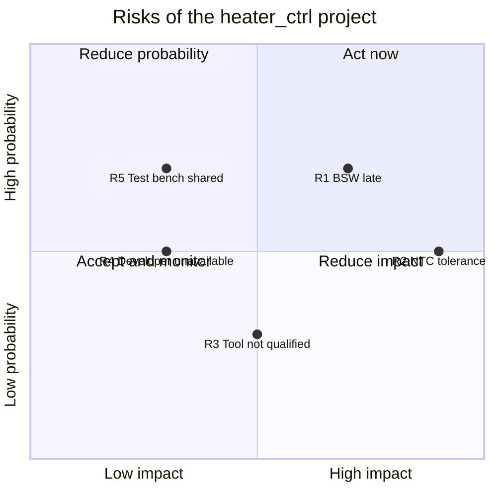

<!-- Generated by spec-figures scripts/continue_rules.py from llm/ -- edit llm/ there and rerun, don't edit this file. -->

# Figure: Risk matrix

Risks placed by probability and impact, with an optional arrow to the residual risk after mitigation. Typical in the risk chapter of a project manual (ASPICE MAN.5) and in reviews of the risk register.

## TikZ: `\begin{sfRiskMatrix}[options]` … `\end{sfRiskMatrix}`

- **`\Risk{ID}{probability}{impact}{short title}`:** one risk. Probability and impact are whole numbers from 1 (lowest) to the number of levels. The ID goes into its cell; ID and title are listed under the matrix. Keep the title to a few words.
- **`\Target{ID}{probability}{impact}`:** residual risk of `\Risk{ID}` after mitigation: dashed arrow from the risk's cell to the target cell, the ID in grey there.
- **`\Levels{name 1, …, name n}`:** names of the probability levels, lowest first (default: very low … very high). **`\ImpactLevels{…}`:** the same for impact.
- **Options:** `levels` = 3, 4 or 5 (default 5); `xlabel` (default Impact), `ylabel` (default Probability).
- **Layout:** fixed grid; probability bottom to top, impact left to right. Cell colour by probability × impact: green / yellow / red (3 levels: green below 3, red from 6; 4 levels: below 4, from 8; 5 levels: below 5, from 15). Several IDs in one cell are comma-separated and wrap.
- **Red marks:** probability or impact not a whole number or out of range, duplicate risk ID, `\Target` for an unknown risk, `\Levels`/`\ImpactLevels` with the wrong number of names, unknown option.

## Mermaid: `quadrantChart`

- `x-axis Low impact --> High impact`, `y-axis Low probability --> High probability`; `quadrant-1` is top right, `quadrant-2` top left, `quadrant-3` bottom left, `quadrant-4` bottom right.
- One point per risk: `R1 short title: [x, y]` with x = impact, y = probability in 0..1. Level k of n levels maps to (k − 0.5) / n, e.g. for 5 levels: 1 → 0.1, 2 → 0.3, 3 → 0.5, 4 → 0.7, 5 → 0.9.
- No colon, brackets or quotes in point names. A quadrant chart has four zones only; there are no cell colours and no target arrows (show residual risk as a second point, e.g. `R1 residual: [0.7, 0.3]`).

## From a table

- Risk register with columns *ID*, *title/description*, *probability*, *impact* → one `\Risk` per row; shorten the description to a short title. Columns *residual probability*/*residual impact* → `\Target`.
- Text levels (low/medium/high, rare … almost certain) → their number on the scale; ask if the scale is unclear. Probability in % → ask for the level boundaries.

## Examples

## TikZ example (tikz/risk.tex)

```latex
% Risk matrix: risks of the heater_ctrl project, with residual risk after mitigation
\begin{sfRiskMatrix}[levels=5]
  \Risk{R1}{4}{4}{PWM driver (BSW) delivered late}
  \Risk{R2}{3}{5}{NTC sensor tolerance above spec}
  \Risk{R3}{2}{3}{Static analysis tool not qualified}
  \Risk{R4}{3}{2}{Key developer unavailable}
  \Risk{R5}{4}{2}{Test bench shared with other projects}
  \Target{R1}{2}{4}
  \Target{R2}{2}{3}
\end{sfRiskMatrix}
```

## Mermaid / Markdown example (mermaid/risk.mmd)


