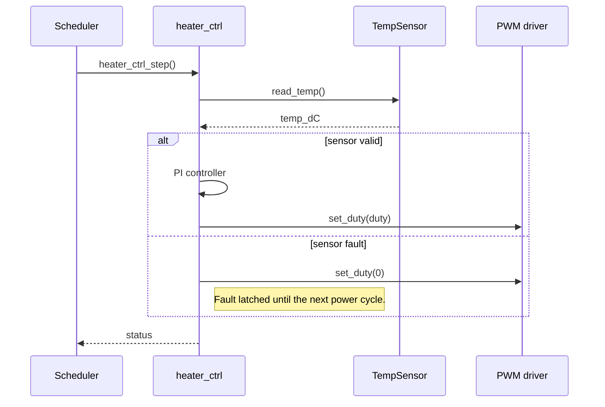

<!-- Generated by spec-figures scripts/continue_rules.py from llm/ -- edit llm/ there and rerun, don't edit this file. -->

# Figure: Sequence diagram

Messages between participants over time: one scenario of a unit or component (a call sequence, a protocol exchange, an error path). Typical in the design and test chapters of unit and component specifications.

## TikZ: `\begin{sfSequence}[options]` … `\end{sfSequence}`

- **`\Participant{ID}{label}`:** a software unit, component, driver or system; drawn as a box with a lifeline. `\Actor{ID}{label}`: a person or external actor (stick figure). Declare all participants first, left to right.
- **`\Message{from}{to}{label}`:** synchronous call (solid arrow). `\Async{from}{to}{label}`: asynchronous message (open arrow). `\Reply{from}{to}{label}`: return (dashed).
- **`\Self{ID}{label}`:** a call to itself (loop on the lifeline).
- **`\Note{ID}{text}`:** note right of the lifeline, takes the vertical space it needs.
- **`\Fragment{kind}{guard}` … `\EndFragment`:** combined fragment around the events between them; `kind` is `alt`, `opt`, `loop`, `par`, `break` or `critical`, guard e.g. `every 10 ms`. `\Else{guard}` divides an `alt`. Fragments may be nested.
- **`\Gap`:** extra vertical space.
- **Options:** `xstep` (distance between participants, default 3.2cm), `step` (row height, default 0.75cm).
- **Layout:** participants in declaration order, one row per event from top to bottom. Long labels need a larger `xstep`.
- **Red marks:** unknown or duplicate participant, `\Else` outside a fragment, unbalanced `\Fragment` / `\EndFragment`.

## Mermaid: `sequenceDiagram`

- `participant ID as Label` (or `actor ID as Label`), declared first in the wanted order.
- `A->>B: text` call, `A-)B: text` async, `B-->>A: text` reply, `A->>A: text` self call.
- `alt guard` … `else guard` … `end`, `opt`, `loop`, `par` … `and` … `end`, `critical`, `break`.
- `Note right of A: text` (or `left of`, `over A,B`).
- No `;` and no `#` in message texts (Mermaid reads them as separators and entities).

## From a table

- One row per message, columns *from*, *to*, *message*, optional *type* (call / async / reply / note) → one `\Message`/`\Async`/`\Reply`/`\Note` per row in the same order. Participants: the distinct *from*/*to* values in order of first appearance.

## Examples

## TikZ example (tikz/sequence.tex)

```latex
% Sequence diagram: one control cycle of heater_ctrl
\begin{sfSequence}
  \Participant{sched}{Scheduler}
  \Participant{ctrl}{heater_ctrl}
  \Participant{temp}{TempSensor}
  \Participant{pwm}{PWM driver}
  \Message{sched}{ctrl}{heater_ctrl_step()}
  \Message{ctrl}{temp}{read_temp()}
  \Reply{temp}{ctrl}{temp_dC}
  \Fragment{alt}{sensor valid}
    \Self{ctrl}{PI controller}
    \Message{ctrl}{pwm}{set_duty(duty)}
  \Else{sensor fault}
    \Message{ctrl}{pwm}{set_duty(0)}
    \Note{ctrl}{Fault latched until the next power cycle.}
  \EndFragment
  \Reply{ctrl}{sched}{status}
\end{sfSequence}
```

## Mermaid / Markdown example (mermaid/sequence.mmd)


