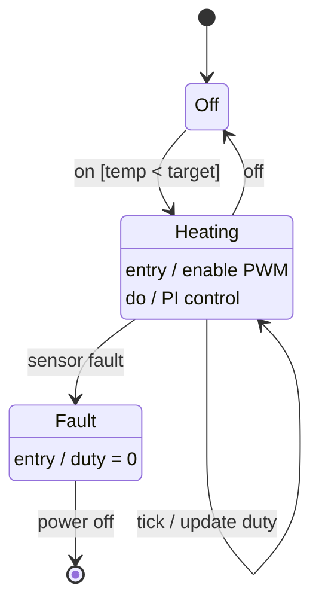

<!-- Generated by spec-figures scripts/continue_rules.py from llm/ -- edit llm/ there and rerun, don't edit this file. -->

# Figure: State machine

States of a unit or component and the transitions between them (modes, protocol states, error handling). Typical in the design chapter of a unit specification and in the functional description of a component.

## TikZ: `\begin{sfStateMachine}[options]` … `\end{sfStateMachine}`

- **`\Initial[c,r]{ID}`:** initial pseudo state (filled dot). `\Final[c,r]{ID}`: final state. `\Choice[c,r]{ID}`: choice pseudo state (diamond).
- **`\State[c,r]{ID}{name}{}`:** a state. The third argument stays empty `{}`.
- **`\Activity{text}`:** an internal activity of the state just declared, e.g. `entry / enable PWM`, `do / PI control`, `exit / ...`; one per line, printed in a compartment under the name.
- **`\Transition[options]{from}{to}{event [guard] / action}`:** arrow between states; from = to draws a loop. Leave the label empty for a completion transition.
- **Options:** `xstep` (default 3.4cm), `ystep` (default 2cm).
- **Layout:** grid `[column,row]`; without a position a state goes right of the previous one. For two transitions between the same states use `[left]` on both so they bend apart.
- **Red marks:** unknown or duplicate state ID, bad position, unknown connection option.

## Mermaid: `stateDiagram-v2`

- `state "Name" as ID` for names with spaces; `ID : entry / text` adds an internal activity.
- `[*] --> ID` initial, `ID --> [*]` final, `A --> B : event [guard] / action`.
- `state ID <<choice>>` for a choice; composite states with `state ID { ... }`.
- No `:` inside transition labels other than the separator after the target.

## From a table

- State transition table with columns *source*, *event*, *guard*, *action*, *target* → one `\Transition{source}{target}{event [guard] / action}` per row; states: the distinct source/target values, placed in rows of up to four.

## Examples

## TikZ example (figures/sample/state.tex)

```latex
% State machine: operating modes of heater_ctrl
\begin{sfStateMachine}
  \Initial[0,0]{init}
  \State[1,0]{off}{Off}{}
  \State[2.5,0]{heat}{Heating}{}
    \Activity{entry / enable PWM}
    \Activity{do / PI control}
  \State[2.5,1.4]{fault}{Fault}{}
    \Activity{entry / duty = 0}
  \Final[1,1.4]{end}
  \Transition{init}{off}{}
  \Transition[left]{off}{heat}{on [temp < target]}
  \Transition[left]{heat}{off}{off}
  \Transition{heat}{fault}{sensor fault}
  \Transition{fault}{end}{power off}
  \Transition{heat}{heat}{tick / update duty}
\end{sfStateMachine}
```

## Mermaid / Markdown example (mermaid/state.mmd)


