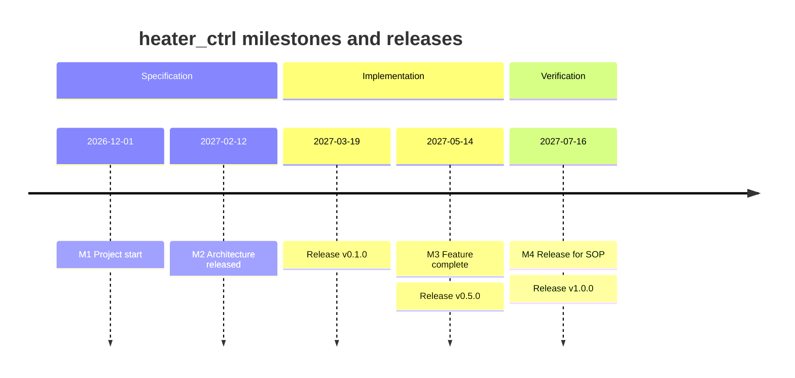

<!-- Generated by spec-figures scripts/continue_rules.py from llm/ -- edit llm/ there and rerun, don't edit this file. -->

# Figure: Milestone timeline

Milestones above a date axis, releases below it, project phases as coloured bands on it. Typical in the project manual (milestones and releases) and in release overviews.

## TikZ: `\begin{sfTimeline}[options]` … `\end{sfTimeline}`

- **`\Milestone{ID}{date}{name}`:** a diamond on the axis, label `ID name` and the date above it.
- **`\Release{version}{date}`:** a triangle on the axis, version and date below it.
- **`\Phase{name}{start}{end}`:** a coloured band just above the axis from start to end, the name inside.
- Dates are `YYYY-MM-DD`.
- **Options:** `width` (length of the axis, default 13.5cm), `today=YYYY-MM-DD` (dashed red line).
- **Layout:** to scale between the earliest and latest date, with a tick at every month and the year at every January. Milestones and releases are sorted by date; their labels alternate between two heights, so neighbours may be close but not too close: events less than about 3 % of the span apart overlap. If any date is not valid, the events are spaced evenly in their given order and the phases are left out.
- **Red marks:** a date that is not `YYYY-MM-DD`, a phase whose end is before its start, `today` not a date.

## Mermaid: `timeline`

- `title …`, then optional `section Name` per phase, then one event line per date: `2027-02-12 : M2 Architecture released`.
- Several events on the same date: further lines starting with ` : ` under it.
- The Mermaid timeline is not to scale: dates are only labels, sorted as written. Write them in date order.
- No `:` inside event texts (it starts a new event); no `#` or `;`.

## From a table

- Columns *type* (milestone / release / phase), *ID or version*, *date* or *start*/*end*, *name* → one `\Milestone`, `\Release` or `\Phase` per row.
- Mermaid: group the rows by phase into `section`s and write one line per date, milestones as `ID name`, releases as `Release version`.

## Examples

## TikZ example (figures/sample/timeline.tex)

```latex
% Milestone timeline: milestones, releases and phases of the heater_ctrl project
\begin{sfTimeline}[today=2027-02-15]
  \Phase{Specification}{2026-12-01}{2027-02-12}
  \Phase{Implementation}{2027-02-15}{2027-05-14}
  \Phase{Verification}{2027-05-17}{2027-07-16}
  \Milestone{M1}{2026-12-01}{Project start}
  \Milestone{M2}{2027-02-12}{Architecture released}
  \Milestone{M3}{2027-05-14}{Feature complete}
  \Milestone{M4}{2027-07-16}{Release for SOP}
  \Release{v0.1.0}{2027-03-19}
  \Release{v0.5.0}{2027-05-14}
  \Release{v1.0.0}{2027-07-16}
\end{sfTimeline}
```

## Mermaid / Markdown example (mermaid/timeline.mmd)


