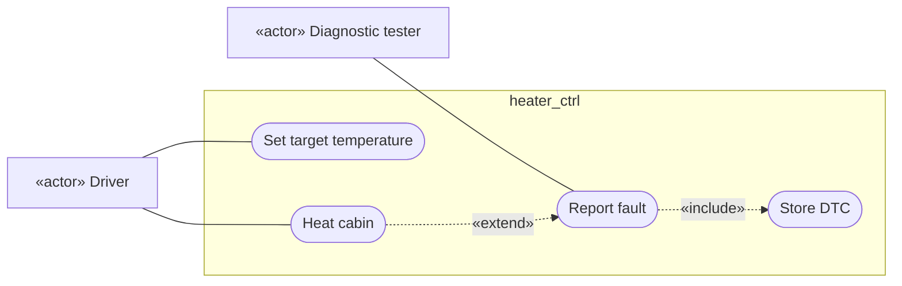

<!-- Generated by spec-figures scripts/continue_rules.py from llm/ -- edit llm/ there and rerun, don't edit this file. -->

# Figure: Use case diagram

Actors and the use cases of a system or component: who uses what. Typical in the introduction or requirements chapter of a component specification.

## TikZ: `\begin{sfUseCase}[options]` … `\end{sfUseCase}`

- **`\System{name}`:** the system boundary, drawn around all use cases (once, optional).
- **`\Actor[c,r]{ID}{name}`:** a person or external system (stick figure). Without a position actors stack in column 0.
- **`\UseCase[c,r]{ID}{name}`:** a use case (ellipse). Without a position use cases stack in column 1.6.
- **`\Association{actor}{use case}`:** an actor takes part in a use case (line).
- **`\Include{base}{included}`**, **`\Extend{extension}{base}`:** dashed arrows labelled «include» / «extend».
- **`\Generalization{child}{parent}`:** between actors or between use cases (hollow triangle).
- **Options:** `xstep` (default 3.2cm), `ystep` (default 1.3cm).
- **Layout:** actors left, use cases right of them, one below the other. Secondary actors on the right: give them a position after the use cases, e.g. `[3.4,1]`.
- **Red marks:** unknown or duplicate ID, bad position.

## Mermaid: `flowchart LR`

- Mermaid has no use case diagram; use a flowchart: actors `drv["«actor» Driver"]`, use cases as stadium shapes `uc([Heat cabin])` inside `subgraph sys [System name]` … `end`.
- Association `drv --- uc`; include/extend `a -. "«include»" .-> b`.

## From a table

- Use case list with columns *use case*, *primary actor*, *secondary actors*, *includes* → one `\UseCase` per row, one `\Actor` per distinct actor, one `\Association` per actor of the row, one `\Include` per entry in *includes*.

## Examples

## TikZ example (figures/sample/usecase.tex)

```latex
% Use case diagram: heater_ctrl and its users
\begin{sfUseCase}
  \System{heater_ctrl}
  \Actor{drv}{Driver}
  \Actor{diag}{Diagnostic\\tester}
  \UseCase{set}{Set target\\temperature}
  \UseCase{heat}{Heat cabin}
  \UseCase{fault}{Report fault}
  \UseCase[3,1]{log}{Store DTC}
  \Association{drv}{set}
  \Association{drv}{heat}
  \Association{diag}{fault}
  \Include{fault}{log}
  \Extend{heat}{fault}
\end{sfUseCase}
```

## Mermaid / Markdown example (mermaid/usecase.mmd)


